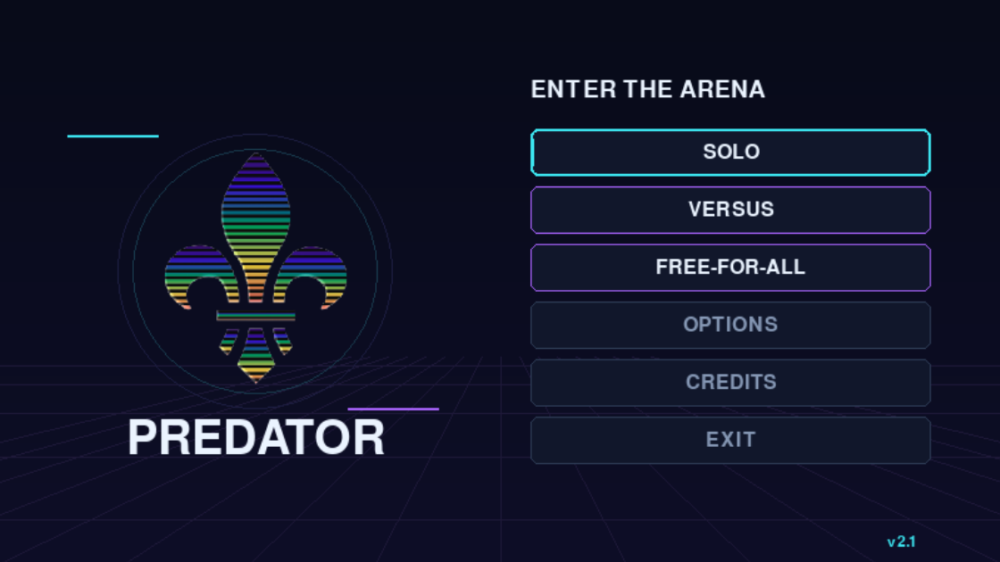
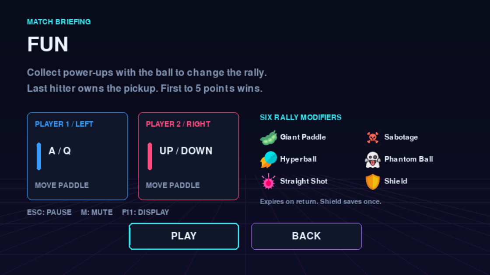

# Predator

**v2.1 ? Arcade Renaissance**

Predator is a local arcade Pong game, formerly **PrHEIdator**. Clement LEROY
created the original as a HEI school project; the old name combined Predator
and HEI. v2.0 ? Game Rebirth modernized its architecture. v2.1 adds one unified
retro-neon interface, a consistent match lifecycle and a playable Fun mode.
The original fleur-de-lis emblem and existing audio remain.



## Install and play

Use **Python 3.11+** and Pygame 2.6.1. From this folder on Windows:

```powershell
python -m venv .venv
.venv\Scripts\python.exe -m pip install -r requirements.txt
.venv\Scripts\python.exe main.py
```

For the existing development environment:

```powershell
.venv_pong\Scripts\python.exe main.py
```

On macOS/Linux use `.venv/bin/python` instead of `.venv\Scripts\python.exe`.
Windows/Python 3.11.15 is the tested environment; other platforms need manual
validation. An absolute path to main.py works from any working directory.

**Pygame is the only third-party dependency.** No network connection, server,
account, Flask, Kafka, NumPy, database or controller app is required. Missing
audio hardware or an audio decoder failure allows silent operation. Missing
required graphics still produce an error rather than a misleading blank UI.

## Modes

| Branch | Mode | Rules |
| --- | --- | --- |
| SOLO | VS COMPUTER | Left paddle against a simple tracking bot; first to 5. |
| SOLO | VS WALL | Score on every right-wall return. A left miss ends the run; no score limit. |
| VERSUS | CLASSIC | Two local players; first to 5. |
| VERSUS | PODER | Classic with two centre-hit charges and a close-range special attack. |
| VERSUS | FUN | Classic with six temporary collectible power-ups; first to 5. |
| FREE-FOR-ALL | FREE-FOR-ALL | Four local paddles. The last hitter scores when the ball exits any side; first to 5. |

There is no neural-network AI, online multiplayer or Lightning effect.

Every match begins with a controls briefing and **PLAY / BACK**, followed by
an unmoving **3?2?1 countdown**. Esc pauses the match. Results remain on screen
until you choose **PLAY AGAIN** or **MAIN MENU**. Restart and Play Again create
a clean match and a new countdown.

## Controls

| Action | Default keys |
| --- | --- |
| Navigate menus | Up / Down and Enter; mouse hover and left click |
| Return to previous menu | Esc |
| Player 1, left paddle | A up / Q down |
| Player 2, right paddle | Up / Down |
| Player 3, top paddle | T left / Y right |
| Player 4, bottom paddle | V left / B right |
| Poder attack, player 1 | Hold S while charged, near and aligned with the ball |
| Poder attack, player 2 | Hold Left arrow under the same conditions |
| Pause / resume | Esc; also automatic pause on focus loss |
| Skip intro | Enter / Space |
| Mute / unmute | M |
| Fullscreen / windowed | F11 or Options |
| Quit | EXIT, window close, or Esc on the home screen |

Bindings retain the school game's defaults. Briefing instructions are generated
from those same mappings. Poder centre-zone returns add one charge, capped at
two. A successful attack uses both charges, sends the ball horizontally and
resets the losing player's charge when a point is scored.

## Fun power-ups

A collectible appears near the centre after a random **6?12 seconds** of active
play. Hit it with the ball. The last hitter owns the effect; before the first
paddle contact, the player serving toward the right owns the pickup.

Only one collectible or temporary effect exists at a time. Most effects end
when the opponent returns the ball or the rally ends. After an effect ends,
a fresh 6?12 second interval begins. Pause/countdown/results never advance
spawn timers, effect ages, physics or scores.

| Power-up | Effect |
| --- | --- |
| Giant Paddle | Your paddle becomes 1.5? its normal height. |
| Sabotage | The opposing paddle becomes 0.65? its normal height. |
| Hyperball | Ball velocity increases by 1.5?, with collision substeps to prevent tunneling. |
| Phantom Ball | A 0.6 second warning precedes invisibility toward the opponent; collisions still work. |
| Straight Shot | A controlled horizontal shot toward the opponent; vertical motion returns after their hit. |
| Shield | One defensive save. Survives opponent returns, consumes itself before a point against you, or clears at rally end. |

The supplied Lightning image is preserved but is **excluded from spawning**.
No power-up artwork was replaced. See [the full Fun rules](docs/FUN_RULES.md).



## Display, audio and options

Rendering uses a logical **800?450** surface in a resizable window, initially
1120?630. Scaling preserves 16:9 with letterboxing and correctly mapped mouse
coordinates. Fullscreen returns to the previous window size.

Options has functional music/SFX volume controls, mute, display mode and reduced
flash. Use Left/Right to adjust a selected volume, or click its slider; Enter
also raises volume by one step. Reduced flash removes trails and transient
collision/point feedback and settles button transitions quickly. Active effect
labels and necessary gameplay warnings remain visible. Full-screen collision
flashes and forced gameplay pauses have been removed.

Preferences save as a small local JSON file after a change:

- Windows: `%LOCALAPPDATA%/Predator/settings.json`
- Linux/macOS: `$XDG_CONFIG_HOME/predator/settings.json`, or
  `~/.config/predator/settings.json` when that variable is unset.

If the file is invalid, defaults load. If saving is unavailable, changes still
apply for the session and Options shows a notice. Background music streams on
one channel; effects are cached separately. Pause freezes both audio streams
and resumes them; restarting or leaving clears old effects.

## Architecture

```text
main.py                         Minimal entry point
src/
  app.py                        One event loop, lifecycle and scaling
  config.py                     Shared dimensions, timing and controls
  entities.py / collisions.py   Ball, paddles and collision responses
  modes.py / powerups.py        Match rules, bot, Poder and Fun effects
  navigation.py                 Screens and edge-triggered menu input
  rendering.py / ui/            Arcade presentation and shared widgets
  assets.py / audio.py          Cached resources and audio lifecycle
  settings.py                   Validated local JSON preferences
assets/
  px/branding/                  Existing logos and titles
  px/powerups/                  Seven supplied icons, six active
  px/fonts/                     Preserved font resources
  px/legacy/                    Preserved unused originals
  snd/music/ / snd/sfx/          Existing gameplay audio
  snd/legacy/                   Retired/unused audio
scripts/                        Local validation and preview tools
docs/                          Architecture, history, audit and reports
  previews/                     Captures from the actual Pygame renderer
  legacy/                       School scripts archived as text
tests/                         Standard-library unittest regression suite
```

See [architecture](docs/ARCHITECTURE.md), [audit](docs/AUDIT.md),
[changelog](CHANGELOG.md), [history](docs/PROJECT_HISTORY.txt) and
[roadmap](docs/ROADMAP.md). Historical v2.0 audit/validation/delivery reports
are retained with `_V2_0` filenames. No historical dates or Git history are inferred.

## Tests and previews

```powershell
.venv_pong\Scripts\python.exe -m unittest discover -s tests -v
.venv_pong\Scripts\python.exe scripts/capture_previews.py
.venv_pong\Scripts\python.exe scripts/smoke_desktop.py
```

Tests use dummy SDL drivers; simulation tests require no graphical window.
The separate desktop smoke check opens a short-lived, muted native window,
runs main.py offline and verifies clean shutdown. It writes no preferences.
Screenshots are captured from the real renderer, not generated concept art.
See [validation](docs/VALIDATION.md) and [delivery report](docs/DELIVERY_REPORT.md).

## Credits and limitations

Original project: **HEI School Project**, original concept and foundational
development. Current development: **Peter Clement LEROY**, game design,
redevelopment and programming. Visual identity: **Original Predator branding**.
The historical school source credits Clement LEROY; that archival record remains
unchanged. See [credits](docs/CREDITS.md).

All original assets and seven supplied placeholders are preserved with
checksum records. The owner states that Predator branding and original game
graphics are their own creations, and third-party visual resources were obtained
under free-use licenses. This does not make every asset public domain; specific
licenses and attribution requirements still apply. Sound and font provenance
require separate review. See [asset review](docs/ASSET_REVIEW.md); no source-code
license or additional licensing terms are invented here.

Physical keyboard rollover, audible output, extended human balance testing,
other operating systems and clean-machine installation still need owner review.
The simple reactive bot and original default controls remain; there are no
remappable bindings in this patch. Fun tuning is an initial implementation,
not a claim of competitive balance. Future v2.2 work should follow playtesting
and rights review; it has not been implemented here.
